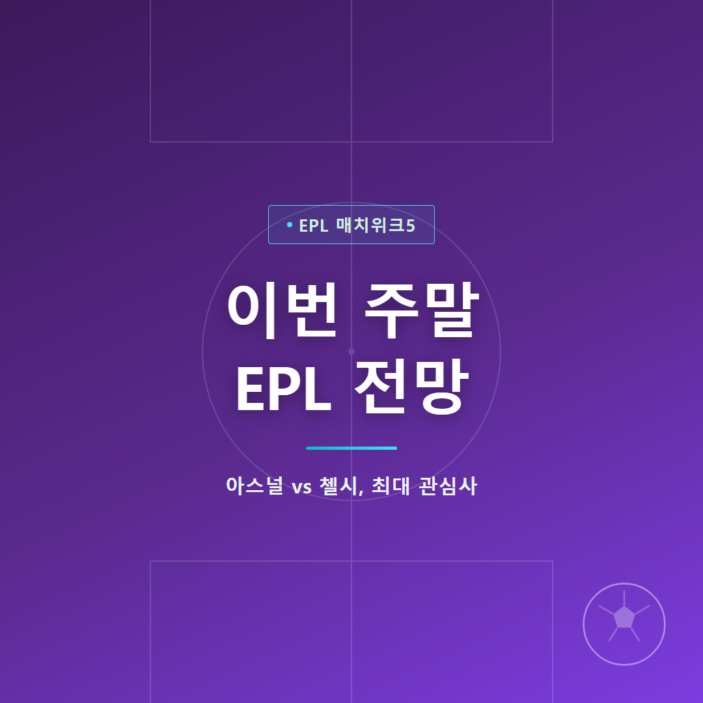
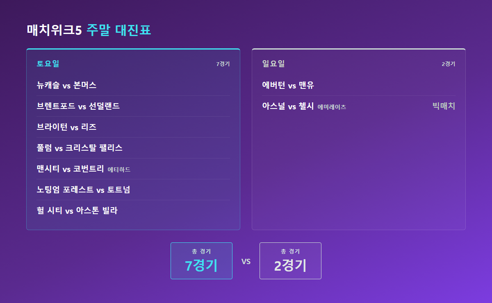
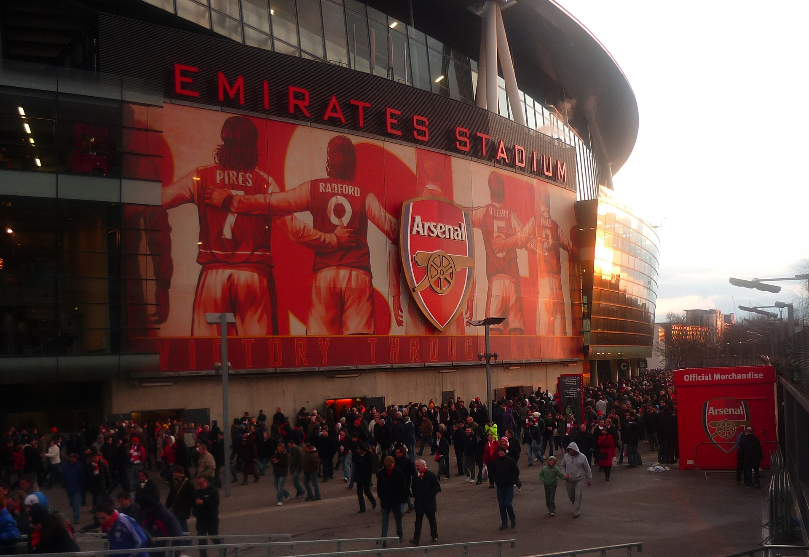
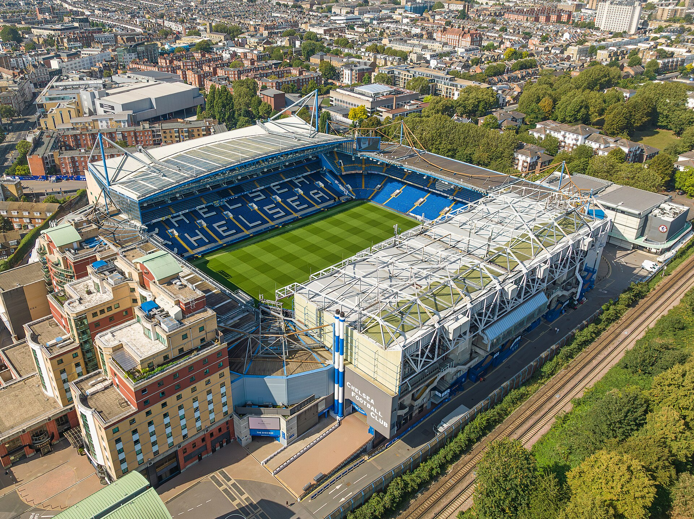
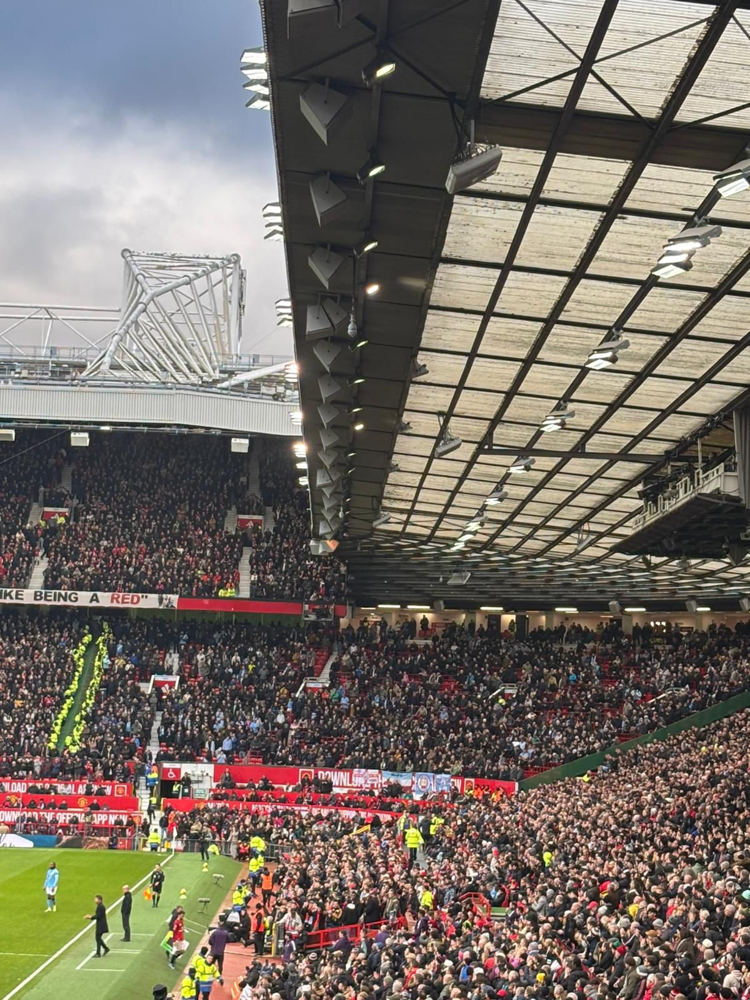

# 프리미어리그 주말 전망, 아스널-첼시전이 핵심 관전포인트

이번 주말 프리미어리그는 매치위크5, 총 9경기가 열립니다.

그중에서도 단연 최대 관심사는 일요일 저녁에 열리는 아스널과 첼시의 맞대결입니다.

오랜 라이벌 관계이기에 이 경기 하나만으로도 이번 라운드 전체가 설명될 정도인데요, 그럼 이번 주말 대진표부터 하나씩 살펴봅시다.

&nbsp;

## 이번 주말 대진표, 한눈에 정리

토요일에는 총 7경기가 몰려 있습니다.

뉴캐슬-본머스, 브렌트포드-선덜랜드, 브라이턴-리즈, 풀럼-크리스탈 팰리스가 먼저 열리고, 이어서 맨체스터 시티가 에티하드에서 승격팀 코번트리 시티를 상대합니다.

같은 시간 노팅엄 포레스트는 홈에서 토트넘을 맞이하고, 저녁에는 헐 시티와 아스톤 빌라가 맞붙습니다.

일요일에는 에버턴이 홈에서 맨체스터 유나이티드를 상대하고, 이어서 이번 라운드 최대어인 아스널-첼시전이 에미레이츠에서 열립니다.

다만 정확한 국내 중계 시간은 발표 전 재확인이 필요한 부분이기에, 굳이 여기서 시간까지 단정하지는 않겠습니다.

한 가지 눈에 띄는 점은 리버풀이 이번 주말 경기가 없다는 것입니다. 직전 입스위치전을 치른 뒤 다음 경기가 9월 12일 풀럼전으로 잡혀 있어, 이번 매치위크 주말 라운드에는 리버풀이 빠져 있는 상황입니다.

사진: Julian Osley · CC BY-SA 2.0 · Wikimedia Commons (출처: https://commons.wikimedia.org/wiki/File:The_Emirates_Stadium_-_geograph.org.uk_-_1717235.jpg)

&nbsp;

## 빅6는 지금 어떤 상황일까

일단 맨체스터 시티는 홈에서 코번트리를 상대하는데, 제레미 도쿠가 부상에서 복귀가 임박했다는 이야기가 나오고 있습니다. 다만 최근 경기력이나 과르디올라 감독의 구체적인 언급까지는 이번 글에서 다루기 어려운 점 양해 부탁드립니다.

아스널은 첼시전을 앞두고 살짝 시끄럽습니다. 위리앙 팀버가 다시 컨디션 저하를 겪고 있다는 이야기가 나오고 있고요, 윌리앙 살리바의 결장 여부를 두고도 한쪽에서는 "최소 10월까지 결장"이라 하고 다른 쪽에서는 "훈련에는 정상적으로 참여 중"이라는 식으로 이야기가 갈리는 중입니다. 아직 정리가 덜 된 사안이기에, 여기서는 양쪽 이야기를 그대로 병기해두는 편이 안전할 것 같습니다.

첼시 쪽은 이번 리서치에서 최근 폼이나 부상자 명단이 확인되지 않았습니다. 감독 관련해서도 여러 이야기가 도는데, 서로 다른 인물이 언급되고 있어 굳이 이 글에서 이름을 특정하지는 않으려 합니다.

맨체스터 유나이티드는 에버턴 원정인데, 신규 영입생 카를로스 발레바의 발목 부상이 예상보다 심각해 9월 중순까지는 결장할 수 있다는 이야기가 있습니다. 워낙 기대를 모으고 합류한 선수이기에 팬 입장에서는 아쉬운 소식이죠.

토트넘은 노팅엄 포레스트 원정인데, 이번 리서치로는 최근 폼이나 부상자 상황까지는 확인하지 못했습니다.

사진: Arne Müseler · CC BY-SA 3.0 de · Wikimedia Commons (출처: https://commons.wikimedia.org/wiki/File:London_Stamford_Bridge.jpg)

&nbsp;

## 최대 관심 경기, 아스널 vs 첼시

이번 라운드에서 가장 화제성 있는 매치업으로 아스널-첼시가 반복적으로 꼽힙니다.

다만 개인적으로는, 세부적인 최근 상대전적이나 전술 포인트, 스코어 예측까지 이 자리에서 단정하는 건 조심스럽습니다. 검증이 덜 된 정보가 많이 섞여 있기에 굳이 확실하지 않은 이야기를 확정적으로 얹고 싶지는 않습니다.

다만 아스널과 첼시가 프리미어리그를 대표하는 오랜 라이벌이라는 배경 자체는 잘 알려진 사실입니다. 그렇다 보니 이번 시즌 첫 빅매치를 놓고 벌써부터 관심이 뜨거운 것도 자연스러운 흐름으로 보입니다.

결국 이번 경기는 두 팀 모두에게 시즌 초반 분위기를 좌우할 수 있는 한 판이 될 전망입니다. 결과가 어떻게 나올지 궁금합니다.

&nbsp;

## 승격팀과 중하위권 동향

이번 시즌 승격 3팀은 코번트리 시티(25년 만의 복귀), 입스위치 타운(1년 만의 재승격), 헐 시티(9년 만의 복귀)입니다. 이 부분은 여러 소스에서 동일하게 확인돼 신뢰도가 높은 편입니다.

다만 입스위치는 출발이 순탄치 않았습니다. 8월 30일 맨체스터 유나이티드 원정에서 2-5로 크게 패했거든요. 나름 승격팀치고 아쉬운 결과라 할 수 있습니다.

반면 지난 시즌 승격해 이번이 두 번째 시즌인 선덜랜드는 8월 31일 풀럼 원정에서 1-0으로 승리를 거뒀습니다. 승격팀 중에서는 상대적으로 안정적인 출발이라 볼 수 있겠네요.

지난 시즌 강등된 팀은 울버햄튼, 번리, 웨스트햄으로 파악됩니다. 특히 번리는 한 시즌 만에 다시 강등된 셈이라 아쉬움이 클 것 같습니다.

부진팀 쪽에서는 풀럼이 개막 이후 무승점으로 출발한 데 이어 선덜랜드에도 패하면서 감독 경질 배당이 크게 요동치고 있다는 이야기가 나옵니다. 아스톤 빌라 역시 우나이 에메리 감독 체제에서 최근 패배 이후 경질 배당이 오르는 등 압박이 커지는 모습이고요, 노팅엄 포레스트도 비슷하게 감독 관련 이야기가 도는 중입니다. 다만 이 팀들의 구체적인 감독 이름까지는 정보가 엇갈리는 부분이 있어, 여기서는 굳이 단정하지 않고 넘어가겠습니다.

사진: Love1ticket · CC0 · Wikimedia Commons (출처: https://commons.wikimedia.org/wiki/File:Old_Trafford_2025-2026_Season_by_LOVE1TICKET.jpg)

&nbsp;

## 정리하며

일단 이번 주말 프리미어리그는 매치위크5, 9경기 체제로 진행되고 리버풀만 이번 라운드 휴식을 갖습니다.

빅6 쪽에서는 각 팀마다 크고 작은 변수가 있지만, 그중에서도 결국 가장 관심이 쏠리는 건 아스널-첼시전이 아닐까 싶습니다.

승격팀들의 초반 성적도 나름 흥미로운 포인트인데, 입스위치의 대패와 선덜랜드의 선전이 대조적이라 재밌는 경기가 될 것이 분명합니다.

이번 주말 라운드, 결과가 어떻게 나올지 지켜봐야 할 전망입니다.

#프리미어리그 #EPL주말전망 #아스널첼시 #프리미어리그매치위크5 #맨체스터유나이티드 #승격팀 #입스위치타운 #선덜랜드
